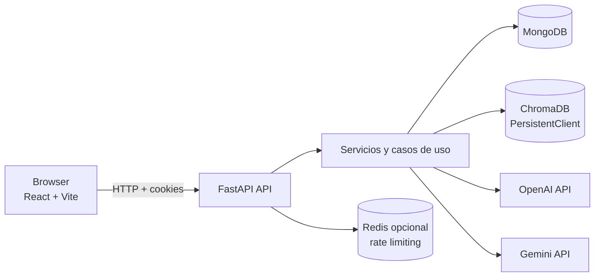
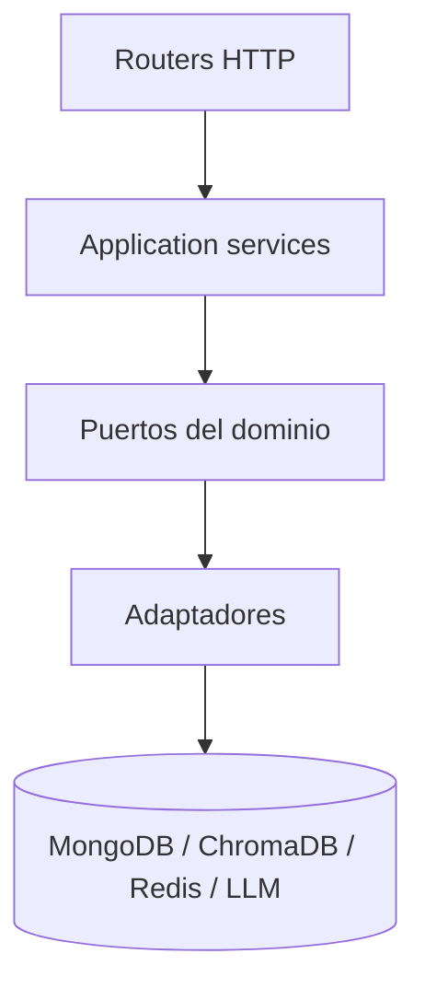

# Arquitectura

La aplicación usa un monolito modular: una API FastAPI contiene los casos de
uso y adaptadores de infraestructura, mientras React consume sus endpoints.

## Capas

- **Presentación:** routers FastAPI, schemas Pydantic y cliente React.
- **Aplicación:** `RAGService`, `AuthService`, `AdminService` y servicios de
  sesión coordinan los casos de uso.
- **Dominio:** modelos, estados y puertos abstractos.
- **Infraestructura:** adaptadores MongoDB, ChromaDB y LLM, lectores de archivos
  y el limiter.

## Fronteras de datos

MongoDB identifica cada documento por sesión, propietario y checksum. ChromaDB
añade `session_id`, `document_id`, `owner_email` y proveedor a los metadatos de
cada fragmento. Las consultas siempre filtran por el ámbito actual.

Los embeddings de OpenAI y Gemini son incompatibles entre sí, por lo que cada
proveedor tiene una colección separada. MongoDB conserva el contenido extraído
para permitir la reindexación sin volver a subir el archivo.

## Seguridad y operación

Las cookies de autenticación son `HttpOnly`; las API keys del proveedor viajan
solo en la solicitud. `/health` comprueba que el proceso vive y `/ready` valida
la disponibilidad de MongoDB. El worker de limpieza elimina sesiones vencidas,
archivos y vectores relacionados.
