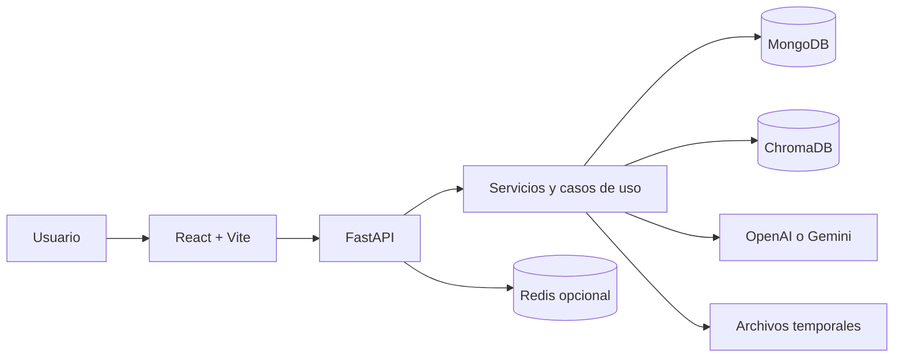
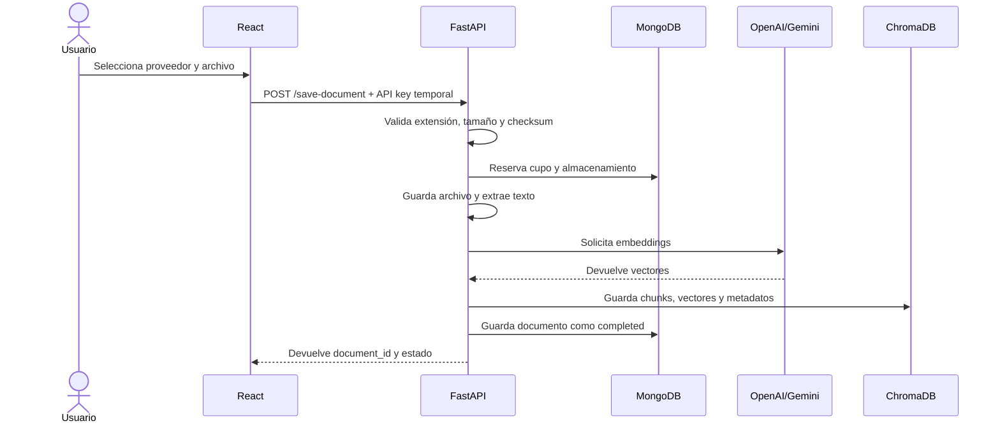
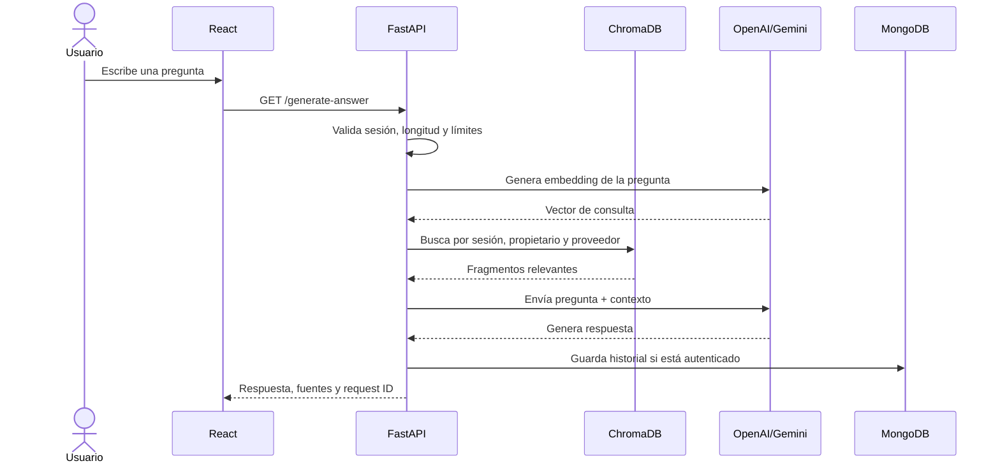

# Guía de presentación del sistema RAG

## Propósito

Esta guía explica `Proyecto-IS2` a un desarrollador que necesita entenderlo
rápidamente. Presenta cómo funciona el sistema completo, qué responsabilidad
tiene cada componente y por qué se tomaron las principales decisiones técnicas.

---

## 1. ¿Qué es el proyecto?

Es una plataforma web para cargar documentos PDF, DOCX o TXT y hacer preguntas
sobre su contenido con respuestas acompañadas de fuentes.

El flujo principal es:

1. Crear una sesión.
2. Cargar un documento.
3. Extraer y dividir su texto en fragmentos.
4. Generar embeddings.
5. Guardar los fragmentos vectorizados.
6. Hacer una pregunta.
7. Recuperar los fragmentos más relevantes.
8. Generar una respuesta usando esos fragmentos como contexto.

El usuario puede seleccionar OpenAI o Google Gemini por solicitud y entregar su
propia API key mediante **BYOK** (*Bring Your Own Key*).

La idea central es:

> El modelo no responde únicamente con conocimiento general; primero se buscan
> fragmentos relevantes dentro de los documentos y luego se genera una respuesta
> usando ese contexto.

---

## 2. Vista general de la arquitectura



| Componente | Responsabilidad |
| --- | --- |
| React + Vite | Interfaz, sesiones, carga de archivos y preguntas |
| FastAPI | API HTTP, autenticación, validación y coordinación |
| Servicios | Indexación, recuperación, generación y sesiones |
| MongoDB | Usuarios, documentos, estados, sesiones e historial |
| ChromaDB | Fragmentos vectorizados y búsqueda semántica |
| OpenAI/Gemini | Embeddings y generación de respuestas |
| Redis | Rate limiting compartido en despliegues con varias réplicas |
| Media | Copias temporales de los archivos cargados |

La aplicación usa un **monolito modular**: hay un solo backend FastAPI, pero sus
responsabilidades están separadas mediante routers, servicios, puertos y
adaptadores. Esto simplifica el despliegue sin mezclar toda la lógica.

---

## 3. Por qué MongoDB y ChromaDB están separados

Esta es una de las decisiones principales del sistema.

### MongoDB: información operacional

MongoDB es la fuente de verdad para:

- Usuarios y roles.
- Sesiones.
- Documentos cargados.
- Nombre, tamaño y checksum.
- Estado del procesamiento.
- Proveedor utilizado.
- Proveedores para los que existe índice.
- Historial de preguntas autenticadas.

Esta información se consulta por identificadores, estados, propietarios y fechas.

### ChromaDB: información semántica

ChromaDB almacena los fragmentos, sus embeddings y los metadatos necesarios para
filtrar la búsqueda. No administra usuarios ni estados de negocio; encuentra el
contenido semánticamente más parecido a una pregunta.

La separación permite que cada tecnología haga una tarea concreta:

```text
MongoDB  → ¿qué documentos existen, quién los posee y cuál es su estado?
ChromaDB → ¿qué fragmentos se parecen más a esta pregunta?
```

Los dos sistemas se relacionan mediante `document_id`, `session_id`, propietario
y proveedor. Esto evita convertir una base vectorial en una base de usuarios o
forzar a MongoDB a resolver búsquedas semánticas.

---

## 4. Por qué cada proveedor tiene su propio índice

Los embeddings dependen del modelo que los genera. Un vector de OpenAI no es
directamente compatible con uno de Gemini, porque pueden usar dimensiones y
espacios semánticos diferentes.

Por eso existen colecciones separadas:

```text
OpenAI → índice de embeddings de OpenAI
Gemini → índice de embeddings de Gemini
```

Un documento puede tener ambos índices:

```json
{"indexed_providers": ["openai", "gemini"]}
```

El contenido extraído se conserva en MongoDB para reindexar el documento con
otro proveedor sin volver a cargarlo ni extraerlo. También se evita mezclar
vectores incompatibles cuando el usuario cambia de proveedor.

---

## 5. Flujo de indexación



### Paso a paso

1. El frontend solicita o reutiliza una sesión.
2. El usuario selecciona OpenAI o Gemini.
3. El archivo se envía junto con la API key del proveedor.
4. FastAPI valida extensión y tamaño máximo.
5. Se calcula SHA-256 para detectar duplicados.
6. MongoDB reserva el cupo de documentos y almacenamiento.
7. El archivo se guarda temporalmente en `media`.
8. `FileReader` extrae el texto según el formato.
9. El texto se divide en fragmentos.
10. El proveedor seleccionado genera los embeddings.
11. ChromaDB guarda vectores y metadatos.
12. MongoDB registra el documento como `completed`.

Los estados principales son:

```text
pending → processing → completed
                     ↘ failed
```

Si la extracción o vectorización falla, el documento se marca como `failed` y
se intenta eliminar el vector parcial y el archivo temporal.

---

## 6. Flujo de una pregunta



RAG (*Retrieval-Augmented Generation*) tiene dos etapas:

1. **Retrieval:** buscar los fragmentos relevantes.
2. **Generation:** generar una respuesta usando esos fragmentos.

El modelo no recibe todos los documentos completos. Recibe una selección de
fragmentos, lo que reduce contexto innecesario y permite asociar la respuesta
con fuentes concretas.

La respuesta incluye texto, documento, título, similitud, proveedor cuando
corresponde y un `X-Request-ID` para diagnóstico.

---

## 7. BYOK y protección de las API keys

El usuario proporciona su propia clave de OpenAI o Gemini. La clave:

- Permanece en el estado de React durante la sesión del navegador.
- Viaja únicamente en la solicitud que la necesita.
- Se envía mediante `X-LLM-API-Key`.
- No se guarda en MongoDB, ChromaDB, cookies ni archivos.
- No se imprime en logs.
- Se pierde al recargar la página.

El backend crea el adaptador del proveedor para cada solicitud. Así no mantiene
una clave de usuario como configuración global ni la persiste accidentalmente.

BYOK permite que cada usuario controle su cuenta, sus límites y sus costos, y
evita depender de una clave global compartida en la plataforma pública.

La clave sigue estando disponible en el navegador durante la sesión. Por eso se
requiere HTTPS y nunca debe almacenarse en `localStorage`, cookies o bases de
datos. BYOK evita la persistencia, pero no convierte el navegador en un entorno
completamente confiable.

---

## 8. Aislamiento de sesiones y documentos

Una pregunta nunca debe recuperar fragmentos de otra sesión o usuario. Cada
fragmento guarda metadatos como:

```text
session_id
document_id
owner_email
provider
```

Las consultas a ChromaDB filtran por el contexto actual. MongoDB también relaciona
cada documento con su sesión y propietario.

### Sesiones anónimas

Una sesión pública se identifica mediante un UUID aleatorio en una cookie
`HttpOnly` llamada `rag_session_id`. La cookie no contiene la API key.

MongoDB guarda únicamente metadatos como `created_at`, `last_activity`,
`expires_at`, `document_count`, `storage_used` y `question_count`.

La sesión expira por inactividad o por un tiempo máximo absoluto. Un worker
periódico elimina de forma coordinada:

1. Documentos de MongoDB.
2. Vectores de ChromaDB.
3. Archivos de `media/sessions`.
4. Sesiones vencidas.
5. Entradas antiguas del rate limiter.

Esto evita documentos huérfanos, vectores sin dueño y archivos acumulados.

### Usuarios autenticados

Los usuarios autenticados pueden consultar sus documentos e historial. Las rutas
protegidas requieren JWT y las operaciones verifican que el documento pertenezca
al usuario correspondiente.

---

## 9. Cómo evitamos abuso y costos descontrolados

Cada sesión tiene límites configurables para:

- Cantidad de documentos.
- Almacenamiento total.
- Tamaño de cada archivo.
- Cantidad de preguntas.
- Longitud de cada pregunta.
- Solicitudes por IP y sesión.

Esto es importante porque cada carga puede generar embeddings y cada pregunta
puede consumir tokens del proveedor.

El rate limiter incluido es local al proceso. Si el backend se despliega con
varias réplicas, debe sustituirse por Redis o por un servicio administrado para
compartir los contadores entre instancias.

---

## 10. Autenticación y roles

El backend usa JWT. El token contiene datos como correo (`sub`), usuario y rol.
El registro público crea usuarios con rol `user`; las rutas administrativas
requieren un token válido con rol `admin`.

Las sesiones anónimas permiten probar el sistema sin registrarse. Las cuentas
permiten conservar documentos e historial asociados al usuario.

La interfaz puede ocultar opciones administrativas, pero la protección real está
en las dependencias de FastAPI que validan el JWT y el rol.

---

## 11. Cómo manejamos fallos y consistencia

### Fallos del proveedor

OpenAI o Gemini pueden rechazar una clave, alcanzar un límite o fallar
temporalmente. El backend convierte esos casos en respuestas HTTP controladas,
evita devolver la clave completa e incluye un request ID para investigación.

### Documento parcialmente procesado

Si MongoDB registra el documento pero falla la vectorización, el estado queda en
`failed` y se intenta limpiar el vector parcial y el archivo temporal.

### Documento duplicado

El checksum SHA-256 se compara dentro de la sesión antes de aceptar otra carga
igual. Así no se consume almacenamiento ni créditos dos veces.

### Reindexación

Si un documento está completado pero no tiene índice para el proveedor actual, se
reutiliza el contenido guardado y solo se genera el nuevo índice.

### Sin contexto

Si no existen documentos indexados para el proveedor seleccionado, la API no
intenta inventar una respuesta: devuelve un error controlado y solicita cargar o
indexar un documento.

---

## 12. Por qué usamos puertos y adaptadores

```text
Router HTTP
    ↓
Servicio / caso de uso
    ↓
Puerto abstracto
    ↓
Adaptador MongoDB, ChromaDB o LLM
```

`RAGService` coordina el flujo sin estar completamente acoplado a una librería
concreta. Los adaptadores contienen los detalles de OpenAI, Gemini, MongoDB y
ChromaDB.

Los beneficios son probar con adaptadores simulados, cambiar infraestructura sin
reescribir casos de uso, mantener routers delgados y hacer explícitas las
dependencias.

Las capas conceptuales son:

- **Presentación:** routers FastAPI y schemas Pydantic.
- **Aplicación:** `RAGService`, autenticación, sesiones y administración.
- **Dominio:** modelos, estados y puertos.
- **Infraestructura:** adaptadores, lectores de archivos y rate limiter.

---

## 13. Observabilidad y evaluación

Cada consulta genera un `request_id`. Los logs registran proveedor, etapas,
cantidad de fuentes, duración y tipo de error, pero no deben registrar API keys
ni preguntas sensibles completas.

Los endpoints operativos son:

- `/health`: confirma que el proceso está vivo.
- `/ready`: comprueba dependencias como MongoDB.

Las pruebas automatizadas usan adaptadores simulados para no gastar créditos ni
exponer credenciales. Verifican inyección de API keys, aislamiento por sesión,
fuentes en las respuestas, errores sin secretos, índices separados y
reindexación.

La evaluación manual debe comprobar preguntas respondibles y no respondibles,
correspondencia de fuentes, aislamiento entre sesiones y comportamiento con
ambos proveedores. A futuro pueden medirse Recall@k, precisión de fuentes,
exactitud, latencia, errores y costo promedio.

---

## 14. Resumen para la reunión

> Este proyecto es una plataforma RAG que recibe documentos y permite hacerles
> preguntas. FastAPI coordina el flujo: extrae el texto, lo divide, solicita
> embeddings al proveedor elegido y guarda los vectores en ChromaDB. MongoDB
> conserva la información operacional, como usuarios, documentos, estados y
> sesiones. Separamos ambas bases porque una administra datos de negocio y la
> otra hace búsqueda semántica.
>
> Las preguntas primero recuperan fragmentos filtrados por sesión, propietario y
> proveedor; después esos fragmentos se envían al modelo para generar la
> respuesta con fuentes. Usamos BYOK para que cada usuario entregue su propia
> API key, que nunca se almacena. La seguridad se completa con cookies HttpOnly,
> JWT, roles, límites de uso, aislamiento de vectores y limpieza de sesiones.

---

## Documentación relacionada

- [README del proyecto](../README.md)
- [Arquitectura](ARCHITECTURE.md)
- [Flujo RAG](RAG_FLOW.md)
- [Seguridad](SECURITY.md)
- [Ciclo de vida de sesiones](SESSION_LIFECYCLE.md)
- [API](API.md)
- [Observabilidad](OBSERVABILITY.md)
- [Evaluación del RAG](RAG_EVALUATION.md)
- [Despliegue](DEPLOYMENT.md)
- [Patrones de diseño](DESIGN_PATTERNS.md)
