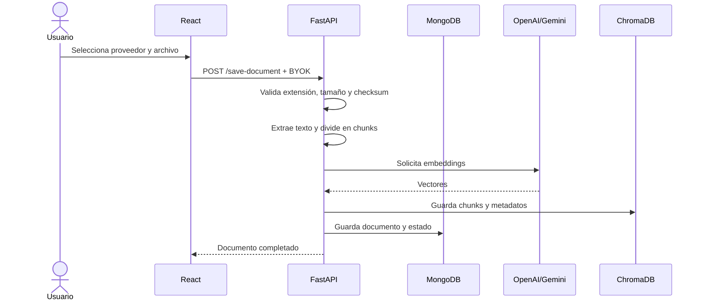
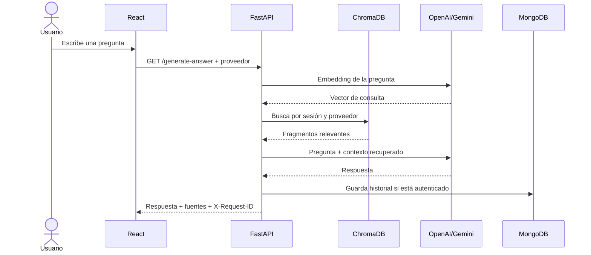

# Flujo RAG

## Indexación

## Consulta

## Reindexación

Si el documento está `completed` pero no tiene índice para el proveedor actual,
la interfaz muestra `Index for Gemini` o `Index for OpenAI`. `POST
/session/documents/{document_id}/index` reutiliza el contenido guardado, genera
los embeddings del proveedor seleccionado y actualiza `indexed_providers`.

## Aislamiento

La recuperación nunca cruza sesiones ni proveedores. Un documento puede tener,
por ejemplo, `indexed_providers: ["openai", "gemini"]`, pero cada índice vive
en su colección vectorial correspondiente.
